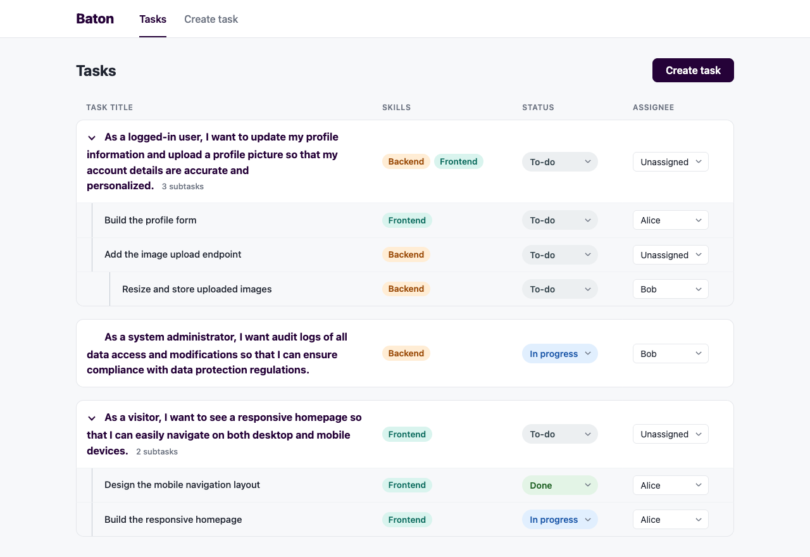
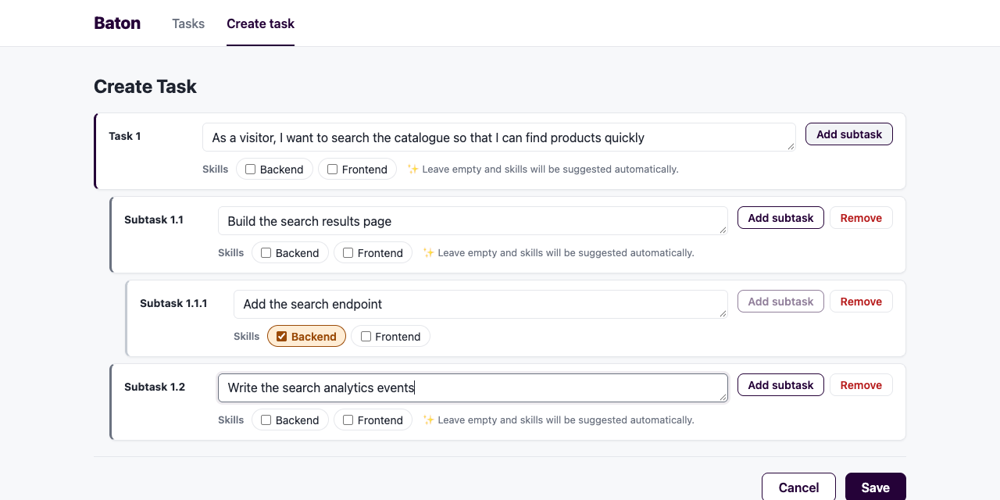
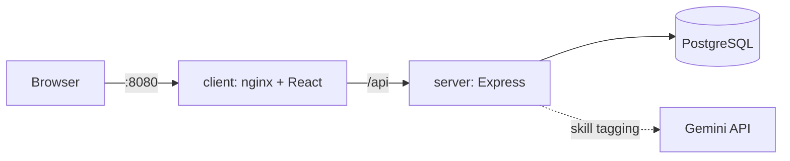
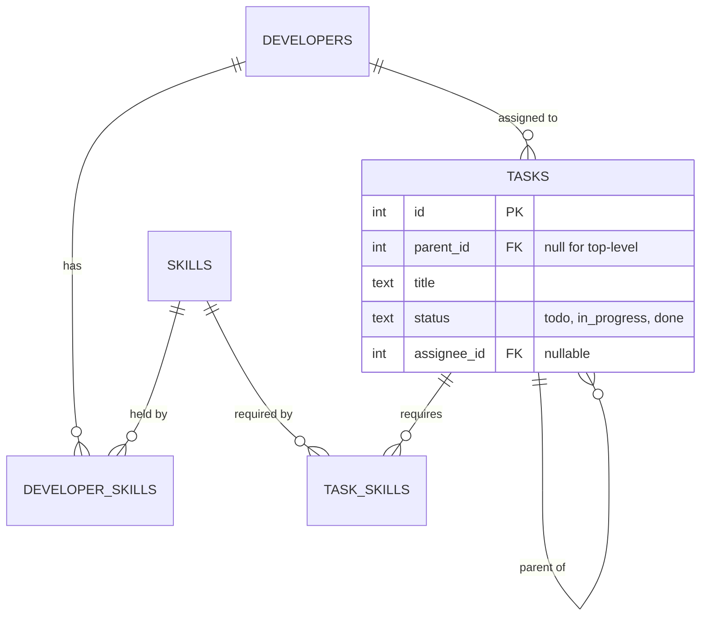

# Baton: skill-based task assignment

A task manager where tasks need skills and can only go to developers who have all of them. Tasks can have nested subtasks, and an LLM tags tasks that are created without skills.

- Skill-restricted assignment, enforced on the server.
- Subtasks up to 3 levels deep. A task is Done only when all its subtasks are Done.
- Leave skills empty and Gemini picks them from the title.
- Starts the database, API and app with a single `docker compose up --build`.

| Task list | Create task |
| --- | --- |
|  |  |

## Quick start

Requires Docker with Compose, and ports 8080 and 5432 free.

```bash
cp .env.example .env     # then add your GEMINI_API_KEY
docker compose up --build
```

Open **http://localhost:8080**. On start the server runs the migrations, seeds the data (Alice, Bob, Carol, Dave; Frontend, Backend) and starts the API. The seed is safe to repeat. `docker compose down -v` resets the data.

| Service | Port | Notes |
| --- | --- | --- |
| `client` | 8080 | nginx serves the React app and proxies `/api` |
| `server` | 3000 (internal) | Express API |
| `db` | 5432 | PostgreSQL 18 |

## Configuration

Set these in `.env`.

| Variable | Purpose |
| --- | --- |
| `POSTGRES_USER`, `POSTGRES_PASSWORD`, `POSTGRES_DB` | Database credentials |
| `PORT` | API port (3000) |
| `DATABASE_URL` | Database URL when running the server outside Docker |
| `GEMINI_API_KEY` | Key for skill tagging. Without it the app still works; tasks just stay untagged |
| `GEMINI_MODEL` | Default `gemini-3.5-flash-lite` |

A variable already set in your shell overrides `.env`.

## Local development

Needs Node 22+ and the `.env` from the quick start.

```bash
docker compose up -d db
cd server && npm install && npm run migrate && npm run seed && npm run dev   # :3000
cd client && npm install && npm run dev                                      # :5173, proxies /api
```

In each package: `npm test`, `npm run lint`, `npm run typecheck`. Server tests need the database running. They create their own `baton_test` database and refuse to wipe any database not ending in `_test`.

## Testing

- **Server:** Vitest and supertest against a real PostgreSQL test database. A fake classifier stands in for the LLM, so no test calls Gemini.
- **Client:** Vitest and React Testing Library.
- Every business rule below has tests.

## System design



**Server.** Routes (HTTP, zod validation) call services (business rules, transactions), which call repositories (plain SQL via `pg`). Rules live in services, not in routes or the UI. Typed errors become `{ "error": { "code", "message", "details" } }` with the right status.

**Data.** SQL migrations, no ORM. A subtask is a normal task row with a `parent_id`, so it has the same properties as a task and the same rules. Recursive queries read subtrees.



**Business rules**

| Rule | Failure |
| --- | --- |
| A developer needs **all** of a task's skills to be assigned. A task with no skills can go to anyone. | 409 `SKILL_MISMATCH` |
| A task can be Done only if **all** its descendants are Done. | 409 `INCOMPLETE_SUBTASKS` |
| Setting a task to To-do or In progress reopens its Done ancestors to In progress. | |
| At most 3 levels and 100 tasks per request. | 400 `VALIDATION_ERROR` |
| A task tree is created in one transaction. An unknown skill id saves nothing. | 422 `INVALID_REFERENCE` |

These live in `server/src/services`.

**Skill tagging.** Before the transaction opens, `createTask` asks a `SkillClassifier` for the skills of each task without any.
- One Gemini call per task, 5 at a time, 8-second timeout.
- The prompt lists the skills from the database. The answer must be a JSON array of those names, and is checked again afterwards.
- If a call fails, the error is logged and the task is saved without skills.
- Tasks with chosen skills are never classified.

**Client.** React and Vite, with React Router for the two pages and TanStack Query for data. API calls live in `api/` and `hooks/`, not in components. The server returns subtasks nested, so the list just renders the tree. The create form holds one immutable tree (`lib/taskFormTree.ts`) and sends it in a single request.

## API

Base path `/api`, JSON bodies.

| Endpoint | Description |
| --- | --- |
| `GET /skills`, `GET /skills/:id` | Skills. One skill includes its developers |
| `GET /developers`, `GET /developers/:id` | Developers with skills. One developer includes their tasks |
| `GET /tasks` | Top-level tasks, newest first, with nested `subtasks` |
| `GET /tasks/:id` | Any task with its subtree |
| `POST /tasks` | Create a task and optional nested subtasks (201) |
| `PATCH /tasks/:id` | Set `status` and/or `assigneeId` (`null` clears it) |

```bash
curl -X POST localhost:8080/api/tasks -H 'content-type: application/json' -d '{
  "title": "Add audit logging",
  "skillIds": [2],
  "subtasks": [{ "title": "Write the log table migration" }]
}'
```

```json
{
  "id": 9, "parentId": null, "title": "Add audit logging", "status": "todo",
  "assignee": null, "skills": [{ "id": 2, "name": "Backend", "addedByAi": false }],
  "createdAt": "…", "updatedAt": "…",
  "subtasks": [
    { "id": 10, "parentId": 9, "title": "Write the log table migration", "status": "todo",
      "assignee": null, "skills": [{ "id": 2, "name": "Backend", "addedByAi": true }], "subtasks": [],
      "createdAt": "…", "updatedAt": "…" }
  ]
}
```

Subtasks without `skillIds` are tagged automatically, and those skills have `addedByAi: true`. To assign and update: `PATCH /api/tasks/9` with `{ "assigneeId": 3, "status": "in_progress" }`.

Errors share one shape:

```json
{ "error": { "code": "SKILL_MISMATCH", "message": "Alice cannot be assigned: missing required skill(s) Backend",
             "details": { "missingSkills": [{ "id": 2, "name": "Backend" }] } } }
```

| Status | Codes |
| --- | --- |
| 400 | `VALIDATION_ERROR`, `INVALID_JSON` |
| 404 | `NOT_FOUND` |
| 409 | `SKILL_MISMATCH`, `INCOMPLETE_SUBTASKS` |
| 413 | `PAYLOAD_TOO_LARGE` |
| 422 | `INVALID_REFERENCE` |

## Libraries

| Library | Used for | Why |
| --- | --- | --- |
| Express 5 | HTTP server | Small and familiar; handles async errors |
| `pg` | Database access | Plain SQL, no ORM to explain |
| `node-pg-migrate` | Migrations | Versioned SQL, run on container start |
| zod | Validation | Checks every request body, with clear errors |
| React, Vite | Client | Required stack; fast builds and dev proxy |
| React Router | Routing | Two pages with deep links |
| TanStack Query | Data fetching | Loading, errors and refresh in one place |
| Vitest, Testing Library, supertest | Tests | One runner for both packages |

No component library: the UI is a table, a form and selects, so native elements with CSS modules are enough. Gemini is called with plain `fetch`, since it is a single endpoint.

## Assumptions

- Statuses: To-do, In progress, Done.
- A task with no skills can be assigned to anyone.
- Skills and developers are read-only, and a task's skills can't change after creation.
- Developer names are unique. A real system would use a stable key such as an email.
- Tasks are created unassigned; assign them from the list.
- Reopening a subtask of a Done task is allowed and moves its Done ancestors to In progress. Other ancestors are left alone.
- Nesting is capped at 3 levels (task, subtask, sub-subtask). It is a product limit, not a schema limit.
- The create form has a Remove button for subtasks. It is not in the wireframe.
- Tagging uses the title only. If Gemini fails, the task is created without skills.

## Layout

```
client/    React app and its nginx config
server/    Express API and SQL migrations
docs/      Screenshots
docker-compose.yml
```
